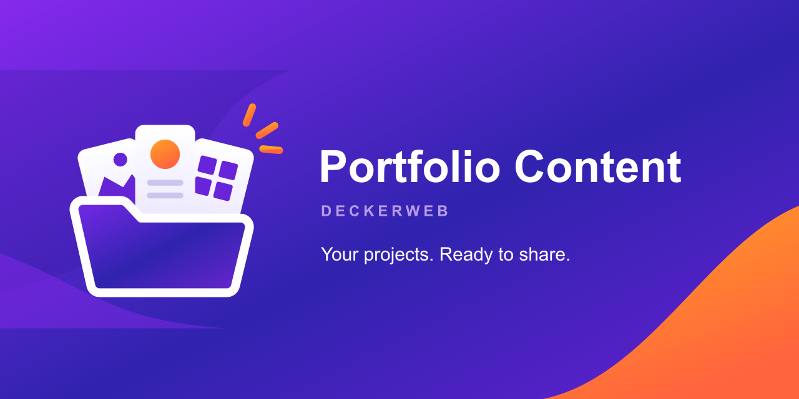
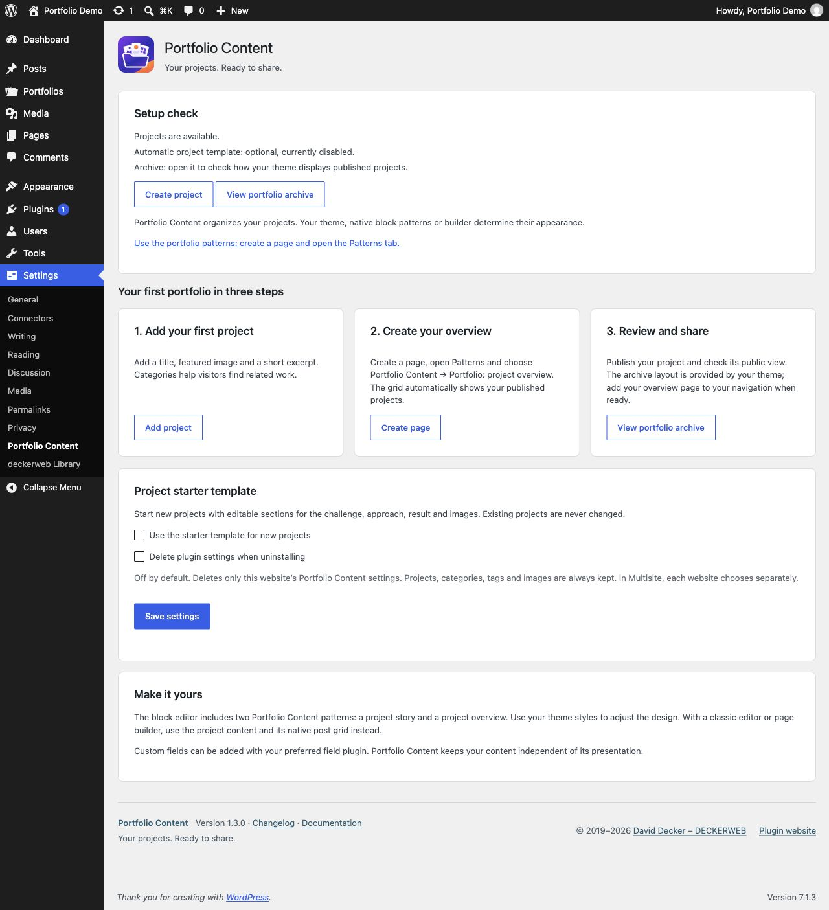
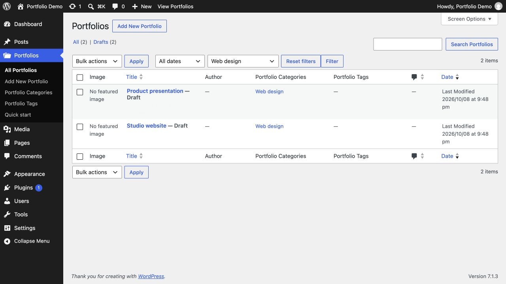
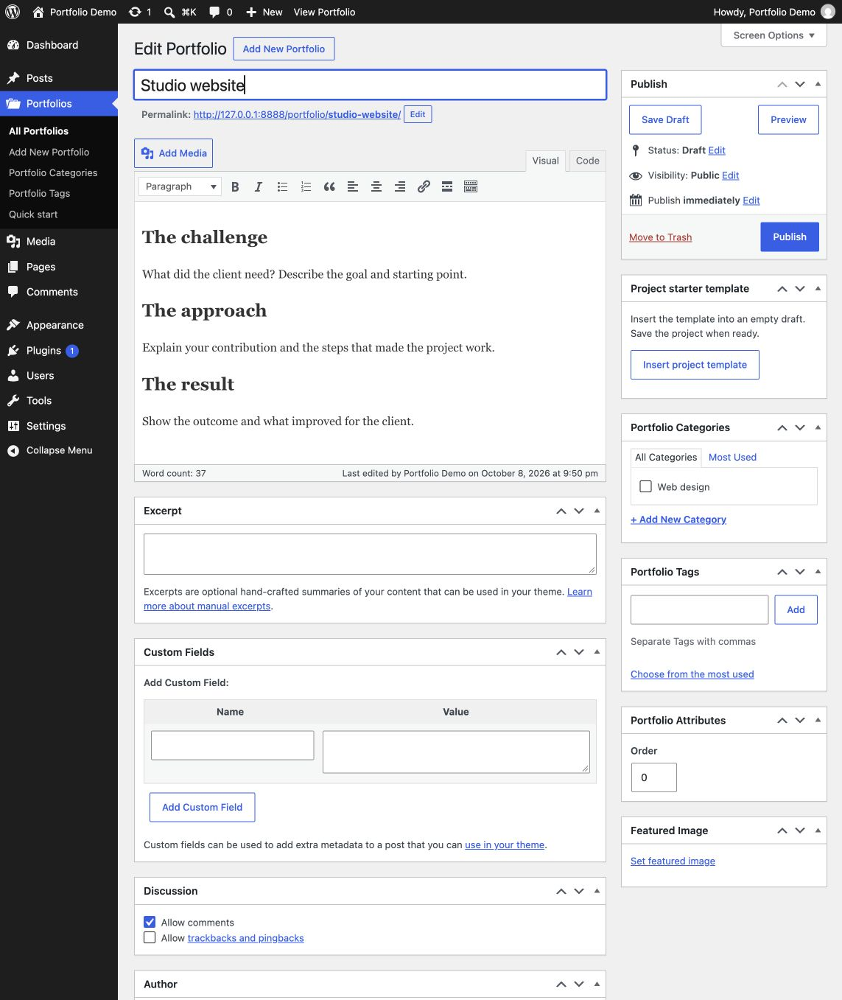
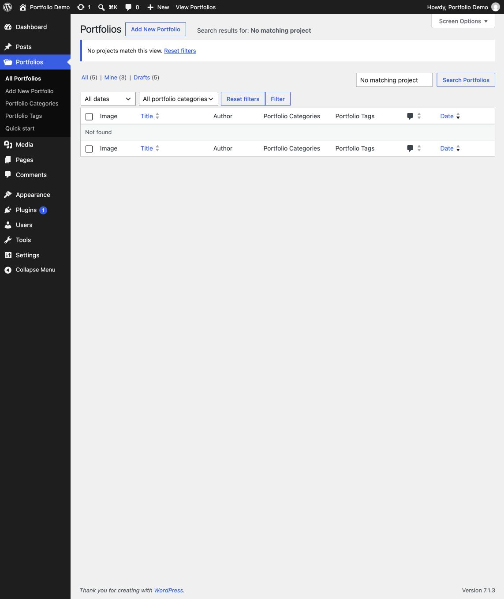

# Portfolio Content

**Your projects. Ready to share.** A lightweight portfolio plugin by David Decker – DECKERWEB: create projects, organize your work and present it with your theme or builder.

**Version:** 1.3.0 · **Requires:** WordPress 6.7+ / PHP 7.4+ · **License:** GPL v2 or later

[Download](https://github.com/deckerweb/portfolio-content/releases/latest) · [User guide](https://github.com/deckerweb/portfolio-content/wiki/English) · [Deutsch](https://github.com/deckerweb/portfolio-content/wiki/Deutsch)

## Contents

- [At a glance](#at-a-glance)
- [Installation and first steps](#installation-and-first-steps)
- [Project starter](#project-starter)
- [Updates and Library](#updates-and-library)
- [Multisite and data](#multisite-and-data)
- [Privacy and connections](#privacy-and-connections)
- [Existing integrations](#existing-integrations)
- [FAQ](#faq)
- [Changelog](#changelog)
- [About the project](#about-the-project)
- [Support and security](#support-and-security)
- [License and provenance](#license-and-provenance)

## At a glance

Portfolio projects with categories and tags, ready for the block editor or your preferred page builder. Your theme controls presentation. No custom front-end scripts, gallery engine or required field plugin.

- Quick start under Settings → Portfolio Content and Portfolio → Quick start.
- Featured-image previews and a category filter in the project list.
- Optional editable project starter: challenge, approach, result and gallery.
- Two native block patterns: project story and responsive project overview with pagination.
- Bundled deckerweb GitHub Release Updater 2.1.0 and deckerweb Plugin Library 0.8.1.
- English, German and formal German interfaces and localized update banners.
- Setup check, manual starter insertion into empty drafts, clickable native category filters, filter reset and helpful empty states.

## Installation and first steps

1. Upload `portfolio-content-1.3.0.zip` under Plugins → Add New → Upload Plugin; activate it.
2. Open Settings → Portfolio Content. Optionally enable the project starter.
3. Add a project with title, featured image and excerpt; publish it.
4. Create a page. In the block inserter's Patterns tab choose Portfolio Content → Portfolio: project overview.
5. Publish the page and add it to your navigation.

The overview uses a native Query Loop: six projects, newest first, three columns and pagination. Adjust these in the editor. Theme styles control appearance. The built-in archive at `/portfolio/` uses your theme's archive template and can look different from the overview page.

For page builders, select `portfolio-content` as the post grid content source and configure image, title and excerpt. Custom fields remain the responsibility of your chosen field plugin. No specific commercial builder integration is included or claimed as tested.

## Project starter

Disabled by default. Enable it in settings to populate new empty auto-drafts only. Existing projects and non-empty defaults remain untouched. It is ordinary editable content, not a locked template. The classic WordPress editor receives headings and paragraphs instead of block markup. The project editor also offers Insert project template for empty drafts, independently of the automatic setting. Current unsaved content is protected; insertion only changes the editor until you save.

## Updates and Library

Updates from public stable GitHub releases appear in the regular WordPress plugin update system. Automatic updates remain your choice. The bundled deckerweb Updater 2.1.0 and plugin validate package identity, offered version and actual WordPress/PHP requirements. Icons and banners are served locally.

The deckerweb Library 0.8.1 adds a catalog under Plugins → Add New. Installation and activation are separate decisions. WordPress.org remains the default. Online catalog retrieval is optional and off by default. On PHP 7.4, portfolio features remain available without the Library.

## Multisite and data

Projects, categories, tags, images and preferences belong to each website. Network activation registers portfolio content on all sites in the network, including newly created sites. The starter and deletion preference are configured separately per website; there is no shared portfolio network setting.

Deactivation preserves all data. Uninstall clears plugin-owned temporary update data. Projects, terms and images always remain. Plugin preferences also remain unless that website explicitly enabled the deletion option. Shared Library data remains while another Library host is installed, including inactive hosts. The final host clears temporary Library data; the Library’s separate, default-off deletion preference applies only to Library settings.

## Privacy and connections

No telemetry. WordPress update checks request public release metadata from api.github.com. Updates download packages from GitHub. The optional online catalog requests JSON from raw.githubusercontent.com/deckerweb; package actions recheck approval. These services receive the IP address and standard HTTP request data, not portfolio content or personal preferences. Documentation, support and donation links are contacted only when opened. For native WordPress package downloads, the default User-Agent may include the WordPress version and site address.

## Existing integrations

Internal identifiers stay `portfolio-content`, `portfolio-category`, `portfolio-tag`. Project URLs and archive remain `/portfolio/`; REST support and post capabilities stay unchanged. Existing filters:

- `pfc/post-type/params`
- `pfc/taxonomy/params-category`
- `pfc/taxonomy/params-tag`
- `pfc/plugins-page/cpt-links`
- `pfc/plugins-page/meta-links`

The meta-links filter is now scoped to this plugin's row. Custom translations under `wp-content/languages/portfolio-content/` remain supported; normal WordPress plugin translations and bundled fallbacks are supported as well.

## FAQ

**Do I need a page builder?** No. The native block patterns work with the WordPress block editor. A builder can use the portfolio post type as a grid source.

**Will it change my website design?** Your theme or builder controls the appearance. The plugin registers content and provides editable native patterns.

**Does the starter change existing projects?** No. It is optional and only fills new empty automatic drafts.

**How do I show my projects?** Create a page and insert Portfolio: project overview from the Patterns tab, or use the theme archive at /portfolio/.

**Do I need a custom field plugin?** No. Title, content, excerpt, featured image, categories and tags are included. Additional fields are optional.

**How do updates work?** Public stable GitHub releases appear in the regular WordPress plugin update system. No separate updater plugin is needed.

**What remains when I deactivate or uninstall?** Projects, categories, tags and images always remain. Preferences remain by default; the deletion option affects only that website’s settings.

[FAQ by topic](https://github.com/deckerweb/portfolio-content/wiki/FAQ-English)

## Screenshots

### Setup check

### Project list and filters

### Project template in the classic editor

## Changelog

### 1.3.0 — 2026-10-08

- **New:** Added a setup check with direct project and archive actions, plus guidance for native patterns.
- **New:** Added manual starter-template insertion into empty drafts in the block and classic editors, with protection for unsaved content.
- **Improved:** Added filter reset, clear missing-image labels and useful actions for empty project lists and searches.
- **Improved:** Updated deckerweb Plugin Library to 0.8.1 and Updater to 2.1.0 with host translations and compatibility handling.
- **Improved:** Refreshed English/German documentation, FAQ, graphics and all German interface translations.
- **Fixed:** Network activation and newly created sites now receive portfolio rewrite rules without changing site preferences.
- **Fixed:** Hardened update-package checks, including native bulk updates, and preserved host translations when component locales load.
- **Misc:** Added optional deletion of plugin settings on uninstall; portfolio content and media are always retained.

### 1.2.0 — 2026-10-01

- **New:** Added quick start, featured-image column and portfolio category filter.
- **New:** Added optional starter content and two native block patterns.
- **New:** Added deckerweb updater v2 and optional Library 0.2.0.
- **Improved:** Preserves existing content identifiers and extension filters.
- **Improved:** Updated English/German documentation and German translations.
- **Fixed:** Corrected minimum WordPress header, translation locale handling, spelling and plugin-row link scope.
- **Fixed:** Removed personal data prefill from the newsletter URL.

### 1.1.0 — 2025-04-07

- **New:** Added plugin links and snippet distribution.
- **Improved:** Portfolio projects use standard WordPress editing and permissions.
- **Improved:** Refresh rewrite rules on activation only.

### 1.0.0 — 2019-05-09

- **New:** Initial public release.

## About the project

David Decker – DECKERWEB has maintained Portfolio Content since 2019. The plugin keeps project content independent of theme or builder presentation. Releases are distributed through GitHub; ClassicPress is not officially supported.

## Support and security

[Bugs and questions](https://github.com/deckerweb/portfolio-content/issues) · [Discussions](https://github.com/deckerweb/portfolio-content/discussions)

Report vulnerabilities privately: [Security reporting](https://github.com/deckerweb/portfolio-content/security/advisories/new). Do not send credentials or private customer content. See [security policy](https://github.com/deckerweb/portfolio-content/blob/master/SECURITY.md).

[Ko-fi](https://ko-fi.com/deckerweb) · [Buy Me a Coffee](https://buymeacoffee.com/daveshine) · [PayPal](https://paypal.me/deckerweb)

## License and provenance

© 2019–2026 David Decker – DECKERWEB · [GPL v2 or later](https://github.com/deckerweb/portfolio-content/blob/master/LICENSE).

Includes deckerweb Library 0.8.1 and deckerweb Updater 2.1.0 by David Decker, both GPL-2.0-or-later. Administration styles and dialog behavior are adapted from Brand Admin Schemes by David Decker, GPL-2.0-or-later. Artwork: approved Portfolio Content Design A by DECKERWEB; SVG sources and PNG exports are provided under GPL-2.0-or-later. System fonts are referenced; no font files are bundled.

GitHub Pages uses the Cayman theme (CC0-1.0); the local layout uses system fonts.

[Library](https://github.com/deckerweb/deckerweb-plugin-library) · [Updater](https://github.com/deckerweb/deckerweb-updater) · [Brand Admin Schemes](https://github.com/deckerweb/brand-admin-schemes) · [Cayman](https://github.com/pages-themes/cayman)

## Empty search results

