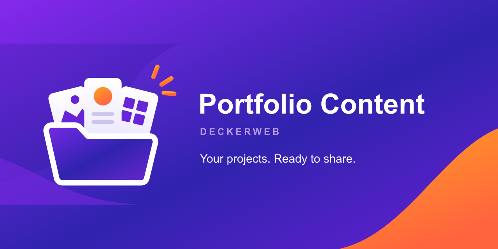

# Portfolio Content

**Your projects. Ready to share. / Deine Projekte. Bereit zum Teilen.**

Projects, categories, tags, editable starter content and native block patterns. Your theme or builder controls the presentation.

Projekte, Kategorien, Schlagwörter, bearbeitbare Projektvorlage und native Block-Vorlagen. Die Darstellung bestimmt dein Theme oder Builder.

## English

- [User guide](English): installation, projects, settings, updates, Multisite and data.
- [FAQ by topic](FAQ-English): everyday questions and technical guidance.
- [Complete changelog](Changelog-English).

## Deutsch

- [Anleitung](Deutsch): Installation, Projekte, Einstellungen, Updates, Multisite und Daten.
- [Fragen nach Themen](FAQ-Deutsch): Alltag und technische Hinweise.
- [Vollständiger Änderungsverlauf](Changelog-Deutsch).

[Download](https://github.com/deckerweb/portfolio-content/releases/latest) · [Issues](https://github.com/deckerweb/portfolio-content/issues) · [Security](https://github.com/deckerweb/portfolio-content/security/advisories/new)
