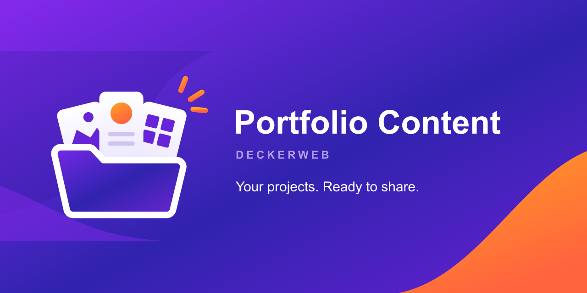

## English

A lightweight portfolio plugin by David Decker – DECKERWEB: create projects, organize your work and present it with your theme or builder.

[User guide](en.html) · [FAQ by topic](https://github.com/deckerweb/portfolio-content/wiki/FAQ-English)

## Deutsch

Ein schlankes Portfolio-Plugin von David Decker – DECKERWEB: Projekte anlegen, übersichtlich verwalten und mit deinem Theme oder Builder präsentieren.

[Anleitung](de.html) · [Fragen nach Themen](https://github.com/deckerweb/portfolio-content/wiki/FAQ-Deutsch)

[Download](https://github.com/deckerweb/portfolio-content/releases/latest) · [GitHub](https://github.com/deckerweb/portfolio-content)
